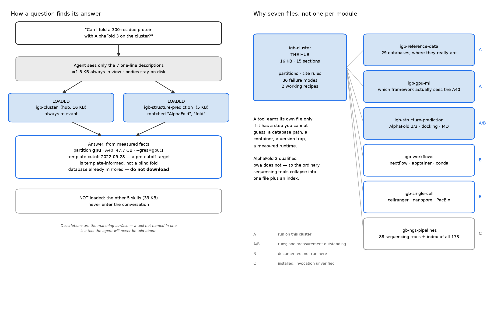

# How this repository is put together

Read this before the skills themselves. It explains what each file is for, how the
agent decides which one to read, and — most importantly — how much of it has actually
been tested.

## The problem

IGB Biocluster 4 has 173 software modules, fifteen partitions of which an ordinary
account can use two, no internet on the compute nodes, and a set of conventions nobody
writes down. Every new lab member rediscovers all of it the hard way, and so does the
agent — from zero, every session.

This repository is that knowledge written down once, in a form the agent loads by
itself. Someone joins the lab, imports it, and their first session already knows
things that otherwise take a month to learn.

## How a skill actually works

Each skill is a markdown file with a header block:

```yaml
---
name: igb-gpu-ml
description: "GPU and deep-learning work on IGB Biocluster 4 — which framework modules
actually see the GPU, how to layer a venv on an IGB PyTorch module... Load before
writing any job that requests --gres=gpu."
---
```

**Only the `description` is always in the agent's view.** The body is read only when a
request matches it. Ask *"I want to fine-tune a protein language model"* and the words
*train*, *GPU*, *torch* match `igb-gpu-ml`; only then is the full file loaded.

This is why the descriptions read like keyword lists rather than prose. They are the
matching surface, not documentation. **A tool not named in a description is a tool the
agent will never be told about** — which is the single most useful thing to know when
editing this repo.



## The files

```
README.md              what the cluster is, headline findings, the tier system
INSTALL.md             3 setup steps, then "read this before you trust anything here"
ARCHITECTURE.md        this file
.gitattributes         forces LF endings - CRLF silently breaks job scripts on IGB
.gitignore

skills/
  igb-cluster/                  <- THE HUB
      SKILL.md                    partitions, site rules, how to submit      15.9 KB
      references/
          partitions.md           the partition map, ceilings, group access   4.9 KB
          databases.md            pointer into the 29 mirrored databases      2.5 KB
          failures.md             36 failure modes with diagnostics          10.3 KB
      recipes/
          af3_monomer.sh          a working AlphaFold 3 job script            1.6 KB
          gpu_pytorch.sh          a working venv-on-module GPU job script     1.5 KB
      kernel.py                   helper functions - see the caveat below    16.1 KB

  igb-reference-data/           29 mirrored databases, where they really are  9.0 KB
  igb-gpu-ml/                   which framework sees the A40; the models      8.7 KB
  igb-ngs-pipelines/            sequencing tools + an index of all 173        5.8 KB
                                references/module-index.csv                  15.6 KB
  igb-structure-prediction/     AlphaFold 2/3, docking, MD                    5.4 KB
  igb-workflows/                nextflow, apptainer, conda                    5.1 KB
  igb-single-cell/              cellranger, nanopore, PacBio                  5.0 KB
```

The whole site layer is about **110 KB**, of which the module index is 16 KB. Only the
hub plus whichever spoke matches the request is ever loaded into a session.

## Why seven files and not one per module

The obvious design is one skill per tool. It fails twice over: a file per module that
nobody maintains, and no way for the agent to pick between them.

Instead: **a hub with spokes.** The hub holds what is true for every job — the
partition map, the memory ceilings, no internet on compute nodes, how to submit, what
breaks and how to recognise it. Every spoke assumes the hub is loaded.

A tool earns its own spoke only when it has a **step you could not have guessed**: a
database path, a container invocation, a version trap, a measured runtime, a known
failure. AlphaFold 3 qualifies — it needs a container, a mirrored database, and takes
far longer than you would budget. `bwa` does not: load the module, run it. So the
ordinary sequencing tools collapse into **one** spoke plus a CSV indexing all 173,
which answers "is X installed, at what version" without a file each.

### One number, one home

Partition hardware — core counts, memory ceilings, node lists, GPU models — lives in
**`igb-cluster/references/partitions.md` and nowhere else**. Spokes say *which*
partition to use and why; they do not restate the specification. This keeps one thing
to edit when the hardware changes, and keeps the per-request token cost of a spoke
down. `igb-gpu-ml` states the A40's VRAM and compute capability, because those decide
whether a model fits and whether a kernel will build — but not the node's CPU or RAM.

## Confidence tiers

Every claim carries a label saying how it was established.

| tier | meaning | how to treat it |
|---|---|---|
| **A** | someone ran it on this cluster | follow the command shown; the timings are real |
| **B** | the module exists, the invocation is from `module show` or IGB's docs | a good starting point, but nobody has run it |
| **C** | the module is installed, and that is all we know | expect it to be subtly wrong |

**The distinction is not pedantry.** Verification sweeps have repeatedly found claims
that were *wrong* rather than merely unverified:

- reference databases whose module sets a path that **does not exist**
  (`/home/mirrors/...`; the real directory is `/home/mirror`, singular) — still true on
  Biocluster 4 for four of the 29;
- a GPU preflight built on `nvidia-smi`, which was **not on `PATH`** on Biocluster 3
  compute nodes and would have aborted every GPU job in the lab;
- a PyTorch build that passed `torch.cuda.is_available()` and then **crashed** on the
  first GPU operation because it had no kernels for the card.

Assume the remaining tier C rows contain errors of the same kind.

## What the Biocluster 4 migration did to this repository

Biocluster 3 was retired in October 2026. Re-measuring the new cluster invalidated a
large fraction of what was here, which is worth recording as evidence of how fast this
kind of knowledge rots:

| Claim | Biocluster 3 | Biocluster 4 |
|---|---|---|
| module stack | 927 names / 1795 versions | **173 / 212** |
| toolchains | two generations, must not be mixed | **one** (`IGB-gcc-15.2.0`) |
| conda | unusable | **works** (`Miniconda3/26.9.4`) |
| `nvidia-smi` on compute nodes | not on `PATH` | **on `PATH`** |
| TensorFlow + GPU | fixed by loading CUDA + cuDNN | **no working pairing** |
| `/scratch` | present, `TmpDisk=0`, needed a guard | **does not exist** |
| GPU in the general-access partition | earlier generation | **A40, sm_86, 47.7 GB** |
| GPU queue wait | 22-32 h observed | empty; jobs started in under 20 s |
| scanpy / snakemake / SPAdes / salmon | present | **gone** |

Four of those are **reversals** — claims that were correct, carefully verified, and are
now actively misleading. That is the argument for the tier system and for re-measuring
rather than porting.

## How a tier C claim becomes tier A

It cannot happen at a desk. Tier C claims are about tools producing correct output on
real input, and the only thing that settles one is running it on the cluster with your
own data.

So when a run of yours works, send back four things:

    the module string you loaded
    the sbatch resources you requested
    the wall time
    MaxRSS from `seff <jobid>`

Tell the agent in your reply — it will offer to write the correction — or open a PR.
Four lines from one successful run saves everyone after you a queue wait. This is the
only mechanism by which this repository improves.

A skill that turns out to be **wrong** is worth reporting even more than one that
works. The GTDB-Tk entry was fixed exactly that way: a user was told to download a
110 GB database that was already mirrored on the cluster, the agent checked the claim,
found the real path nested three levels deeper, and corrected the skill.

## Testing a change

`docs/SKILL-TESTS.md` holds prompts, each one a realistic request where the obvious
answer is wrong and the correction lives in one of these skills. Run them after any
change — a wrong answer names the file to fix.

## Known limitation: `kernel.py`

`skills/igb-cluster/kernel.py` contains helper functions, but **the GitHub skill
importer strips it** — imported skills are documentation only, and the import log says
so explicitly. Its rules are written out in prose inside `SKILL.md`, so nothing is
lost, but the file itself does nothing for anyone who installs this from GitHub. It is
kept as reference for a future local install path.
