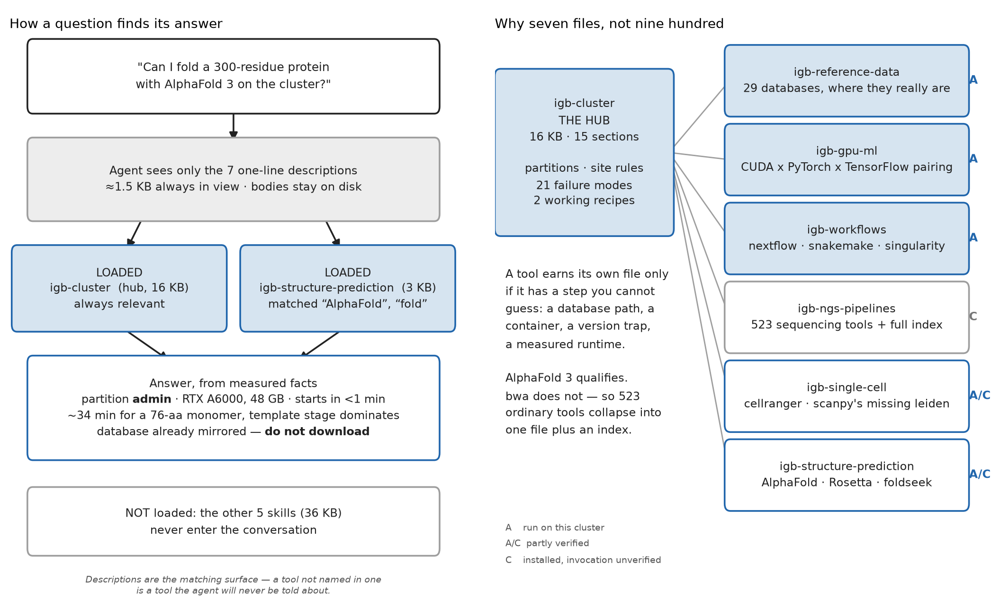

# How this repository is put together

Read this before the skills themselves. It explains what each file is for, how the
agent decides which one to read, and — most importantly — how much of it has actually
been tested.

## The problem

The IGB biocluster has 927 software modules, three partitions with unequal access
granted by Unix group, no internet on the compute nodes, and a set of conventions
nobody writes down. Every new lab member rediscovers all of it the hard way, and so
does the agent — from zero, every session.

This repository is that knowledge written down once, in a form the agent loads by
itself. Someone joins the lab, imports it, and their first session already knows
things that otherwise take a month to learn.

## How a skill actually works

Each skill is a markdown file with a header block:

```yaml
---
name: igb-gpu-ml
description: "GPU and deep-learning work on the IGB biocluster - which CUDA module
pairs with which PyTorch, Tensorflow or JAX build... Load this before submitting any
job that needs a GPU, trains or fine-tunes a model, or imports torch, tensorflow,
jax, transformers or detectron2 on IGB."
---
```

**Only the `description` is always in the agent's view.** The body is read only when a
request matches it. Ask *"I want to fine-tune a protein language model"* and the words
*train*, *GPU*, *torch* match `igb-gpu-ml`; only then is the full file loaded.

This is why the descriptions read like keyword lists rather than prose. They are the
matching surface, not documentation. **A tool not named in a description is a tool the
agent will never be told about** — which is the single most useful thing to know when
editing this repo.



## The files

```
README.md              what the cluster is, headline findings, the tier system
INSTALL.md             3 setup steps, then "read this before you trust anything here"
ARCHITECTURE.md        this file
.gitattributes         forces LF endings - CRLF silently breaks job scripts on IGB
.gitignore

skills/
  igb-cluster/                  <- THE HUB
      SKILL.md                    partitions, site rules, how to submit        16 KB
      references/
          partitions.md           the three partitions, ceilings, group access
          databases.md            pointer into the 29 mirrored databases
          failures.md             21 failure modes with diagnostics
      recipes/
          af3_monomer.sh          a working AlphaFold 3 job script
          scanpy.sh               a working scanpy job script
      kernel.py                   helper functions - see the caveat at the end

  igb-reference-data/           29 mirrored databases, where they really are   13 KB
  igb-gpu-ml/                   CUDA x PyTorch x TensorFlow pairing             7 KB
  igb-workflows/                nextflow, snakemake, singularity                6 KB
  igb-ngs-pipelines/            523 sequencing tools + an index of all 927       5 KB
                                references/module-index.csv                    166 KB
  igb-single-cell/              cellranger, scanpy's missing leidenalg          4 KB
  igb-structure-prediction/     AlphaFold, Rosetta, foldseek                    3 KB
```

## Why seven files and not nine hundred

The obvious design is one skill per tool. It fails twice over: 927 files nobody
maintains, and no way for the agent to pick between them.

Instead: **a hub with spokes.** The hub holds what is true for every job — the
partition map, the memory ceilings, no internet on compute nodes, how to submit, what
breaks and how to recognise it. Every spoke assumes the hub is loaded.

A tool earns its own spoke only when it has a **step you could not have guessed**: a
database path, a container invocation, a version trap, a measured runtime, a known
failure. AlphaFold 3 qualifies — it needs a container, a mirrored database, and takes
33 minutes where you would budget five. `bwa` does not: load the module, run it. So
523 ordinary sequencing tools collapse into **one** spoke plus a CSV indexing all 927,
which answers "is X installed, at what version" without a file each.

## Confidence tiers

Every claim carries a label saying how it was established.

| tier | meaning | how to treat it |
|---|---|---|
| **A** | someone ran it on this cluster | follow the command shown; the timings are real |
| **C** | the module is installed, and that is all we know | a starting point; expect it to be subtly wrong |

There is no tier B left as of 2026-10-13 — everything settleable by inspecting the
cluster has been settled.

**The distinction is not pedantry.** Four verification sweeps were run on 2026-10-13,
and three of them found claims that were *wrong* rather than merely unverified:

- five reference databases whose module sets a path that **does not exist**
  (`/home/mirrors/...`; the real directory is `/home/mirror`, singular);
- a GPU preflight check built on `nvidia-smi`, which is **not on `PATH`** on the
  compute nodes and would have aborted every GPU job in the lab;
- `PyTorch/1.12.1`, which passes `torch.cuda.is_available()` and then **crashes** on
  the first GPU operation because the build has no kernels for the A6000.

Assume the remaining tier C rows contain errors of the same kind.

## How a tier C claim becomes tier A

It cannot happen at a desk. Tier C claims are about tools producing correct output on
real input, and the only thing that settles one is running it on the cluster with your
own data. No remote sweep can promote the 523 NGS modules or the 10x pipelines.

So when a run of yours works, send back four things:

    the module string you loaded
    the sbatch resources you requested
    the wall time
    MaxRSS from `seff <jobid>`

Tell the agent in your reply — it will offer to write the correction — or open a PR.
Four lines from one successful run saves everyone after you a queue wait. This is the
only mechanism by which this repository improves.

A skill that turns out to be **wrong** is worth reporting even more than one that
works. The GTDB-Tk entry was fixed exactly that way: a user was told to download a
110 GB database that was already mirrored on the cluster, the agent checked the claim,
found the real path nested three levels deeper, and corrected the skill.

## Known limitation: `kernel.py`

`skills/igb-cluster/kernel.py` contains helper functions, but **the GitHub skill
importer strips it** — imported skills are documentation only, and the import log says
so explicitly. Its rules are written out in prose inside `SKILL.md`, so nothing is
lost, but the file itself does nothing for anyone who installs this from GitHub. It is
kept as reference for a future local install path.
